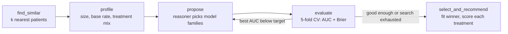

# Agentic Model Selector

[](https://github.com/SamuelJCB/agentic-model-selector/actions/workflows/tests.yml)  

A LangGraph agent that chooses a machine learning model **for each individual patient**, uses it to estimate the probability of response under each treatment option, and keeps the deployed model healthy with a self-adaptive monitoring layer built on AutoGluon.

> **Context.** As a Research Engineer in Boston University Machine Learning Research, I built an agentic LangGraph framework that automates model selection for cancer treatment decisions from patient-specific parameters, together with an LLM-plus-AutoGluon layer for monitoring and retraining. That research code and its clinical data are not public. This repository is an independent reimplementation of the same architecture on a **synthetic cohort**, so that anyone can run it, read it, and test it.
>
> **This is not a clinical tool.** The cohort is simulated, and nothing produced here is medical advice.

## How it works



1. **find_similar** builds a cohort of the patients most similar to the query patient on stage, performance status, biomarkers, and history.
2. **profile** summarizes that cohort: sample size, response rate, treatment mix, and minority-class count.
3. **propose** asks the reasoner which model families fit the profile. The first round pairs an auditable linear baseline with nonlinear ensembles. If nothing clears the AUC target, the graph loops back and the reasoner widens the search.
4. **evaluate** cross-validates every candidate and maintains a leaderboard.
5. **select_and_recommend** fits the winner and scores the patient under every treatment (an S-learner with treatment as a feature), then produces a plain-language summary.

### Two reasoning backends

| Backend | When it runs | What it does |
|---|---|---|
| `LLMReasoner` | `ANTHROPIC_API_KEY` is set | Claude makes each decision and returns structured JSON. Invalid or failed responses fall back to the heuristic backend. |
| `HeuristicReasoner` | default, and in CI | The same decisions as explicit rules, so the graph is deterministic and testable offline. |

### Self-adaptive monitoring

`monitor.py` scores every new batch of labeled outcomes, computes feature drift with the population stability index, and gives that report to the reasoner, which chooses **none**, **recalibrate**, or **retrain**. A retrained challenger (AutoGluon `TabularPredictor`, or a scikit-learn fallback when AutoGluon is not installed) is promoted only if it beats the incumbent on held-out recent data.

## Results

All numbers come from the commands shown, run on the synthetic cohort. Because the data is simulated, the true best treatment for every patient is known, which makes it possible to measure decision quality directly instead of only reporting AUC.

### Per-patient recommendation

```
$ python -m model_selector recommend --example high-tmb

Leaderboard (5-fold CV on similar patients)
  logistic_interactions    AUC 0.739  Brier 0.201  (round 2)
  random_forest            AUC 0.729  Brier 0.203  (round 1)
  knn                      AUC 0.725  Brier 0.203  (round 2)
  logistic_regression      AUC 0.723  Brier 0.205  (round 1)
  xgboost                  AUC 0.723  Brier 0.204  (round 2)
  hist_gradient_boosting   AUC 0.713  Brier 0.208  (round 1)

Estimated probability of response
  immunotherapy   59.4%  #######################
  chemotherapy    25.7%  ##########
  targeted         3.0%  #
```

### Decision quality on 30 held-out patients

`python -m model_selector benchmark --patients 30`

| Approach | Picks the truly best treatment | Mean regret (response probability lost) |
|---|---|---|
| Global logistic regression | 70% | 0.091 |
| Global gradient boosting | 93% | 0.001 |
| **Agent, per-patient selection** | **93%** | **0.001** |

The agent matches the strongest single global model on decision quality, and it does so while choosing an interpretable model (regularized logistic regression with interactions, plain logistic regression, or nearest-neighbor case comparison) for 18 of the 30 patients. Those are the cases where a clinician can inspect exactly why one option scored higher than another.

### Monitoring across four simulated months

`python -m model_selector monitor`

```
backend: autogluon | reasoner: heuristic | reference AUC 0.801

month 1: stable population
  AUC 0.769 (ref 0.801) -> NONE
month 2: older, sicker referrals
  AUC 0.803 (ref 0.801) -> RECALIBRATE: features with PSI > 0.25: ['age', 'tmb_mut_mb']
month 3: new immunotherapy regimen
  AUC 0.699 (ref 0.801) -> RETRAIN
  promoted challenger (0.693 -> 0.718 AUC on held-out recent data)
month 4: new regimen continues
  AUC 0.718 (ref 0.718) -> NONE
```

Covariate drift (month 2) is handled with a cheap recalibration. Concept drift (month 3, where a new regimen changes how biomarkers relate to response) is caught by the AUC drop and triggers a retrain.

## Quick start

```bash
pip install -r requirements.txt
python -m model_selector recommend --example her2      # or high-tmb, proliferative
python -m model_selector benchmark --patients 25
python -m model_selector monitor --backend sklearn

# optional: AutoGluon retraining and Claude-backed reasoning
pip install -r requirements-optional.txt
export ANTHROPIC_API_KEY=...
python -m model_selector --reasoner llm recommend --example high-tmb
python -m model_selector monitor
```

Run the tests with `pytest`. They use the heuristic reasoner and the scikit-learn backend, so they need no API key and no AutoGluon install.

## Project layout

```
model_selector/
  cohort.py       synthetic oncology cohort with known ground-truth response
  candidates.py   model registry with properties the reasoner reasons over
  reasoner.py     Claude-backed and rule-based decision makers
  graph.py        LangGraph state machine
  monitor.py      PSI drift detection, recalibration, AutoGluon retraining
  cli.py          recommend / benchmark / monitor
tests/            pytest suite
```

## License

MIT
